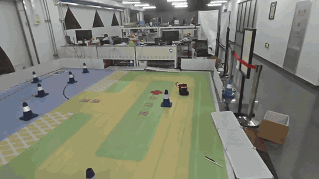
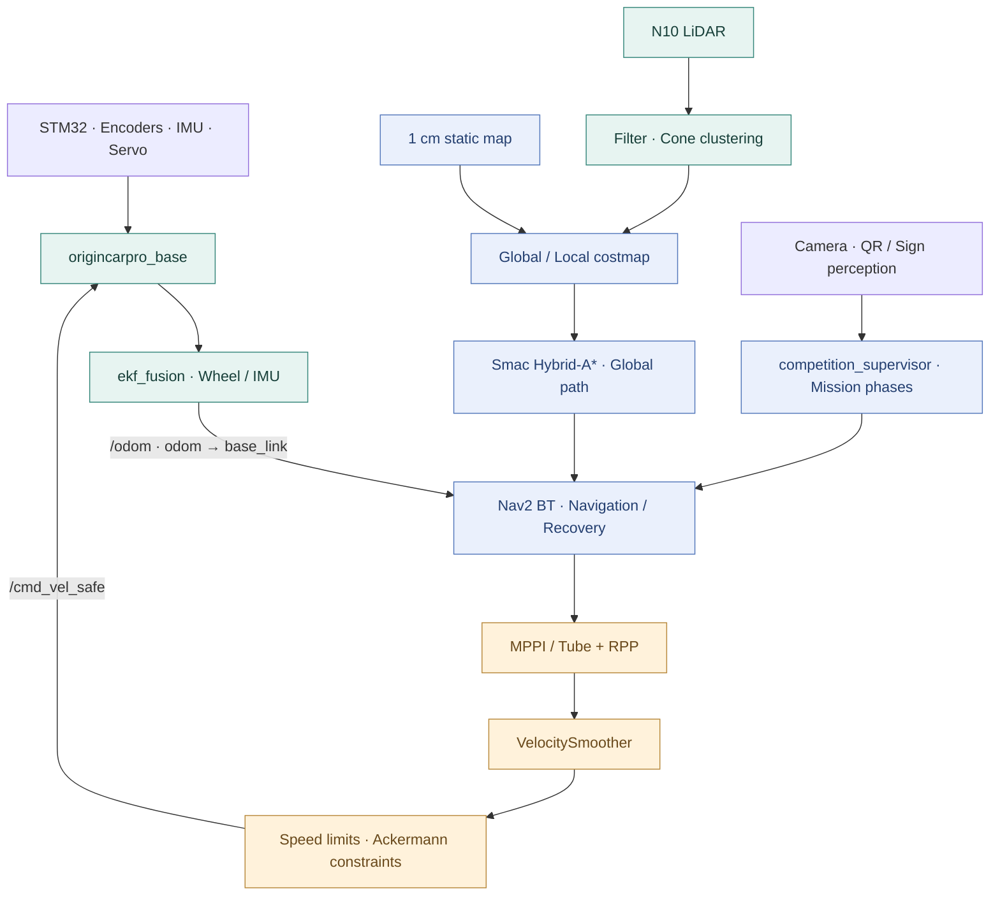
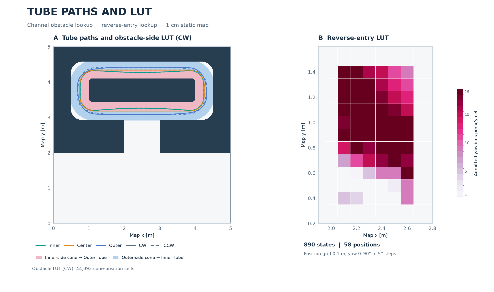
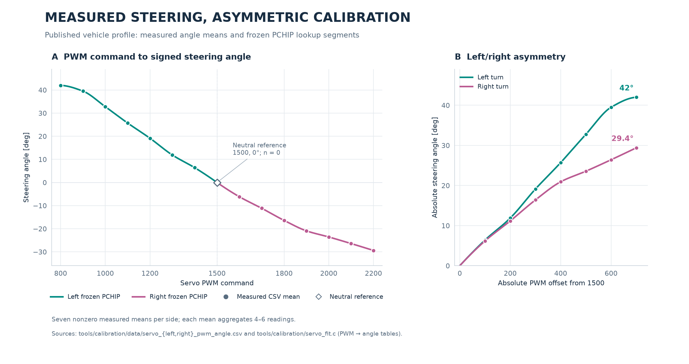

# LoneRover · Ackermann Navigation System

**ROS 2 / Nav2 competition navigation on RDK X5**

[](https://docs.ros.org/en/humble/)


[](LICENSE)

[中文](README.md) · [Demo](#demo) · [Architecture](#architecture) · [Build and run](#build) · [Debugging notes](#debugging)

An Ackermann navigation system developed and tested on a physical competition vehicle. The stack combines wheel/IMU EKF localization, a 1 cm static map, N10 LiDAR cone perception, Nav2, a mission state machine, reverse-entry LUTs, Tube/RPP tracking, and chassis command limiting. I developed this project independently for the 2026 D-Robotics Smart Medical Vehicle competition.

<a id="demo"></a>

## Vehicle demo

[](docs/media/demo.mp4)

**[Watch the full closed-loop demo (MP4)](docs/media/demo.mp4)**

*Full closed-loop sequence: depart from P → scan the QR code and select direction → reverse into the entry using the LUT → follow Tube paths around obstacles in the narrow channel → return to P. The preview is sped up for convenient viewing. The repository includes multiple parameter profiles, from conservative tuning (`safe_05`) to high-speed competition settings (`race_07`–`race_09`), with measured completion times of approximately 35–40 s in the high-speed profiles.*

## Configuration at a glance

| Component | Configuration | Source |
| --- | --- | --- |
| Platform | RDK X5 · ROS 2 Humble / TROS | [Dependencies](docs/DEPENDENCIES.md) |
| Static map | 1 cm per cell | [Map](src/hobot_navigation/hobot_nav/maps/rdk_2026_hospital_static_1cm.yaml) |
| Localization | EKF at 50 Hz | [EKF parameters](src/mycar/ekf_fusion/config/ekf_with_lidar_odom.yaml) |
| Global planning | Smac Hybrid-A* · 0.35 m minimum turning radius | [Nav2 parameters](src/hobot_navigation/hobot_nav/config/nav2_params.yaml) |
| Control / smoothing | Controller / VelocitySmoother at 20 Hz | [Nav2 parameters](src/hobot_navigation/hobot_nav/config/nav2_params.yaml) |

Start here: [Tools](tools/README.md) · [Navigation package](src/hobot_navigation/hobot_nav/README.md) · [Competition entry](src/hobot_navigation/hobot_nav/README_COMPETITION_EN.md) · [Channel tuning](docs/channel_tuning/README.md)

---

## English

### 1. Building the navigation system

The runtime chain starts with chassis feedback and passes through EKF
localization, a static map and dynamic obstacles, SmacPlannerHybrid global
planning, MPPI/RPP local tracking, velocity smoothing, and vehicle constraints.
The final safe command is sent to the chassis by the competition control chain.
Mission-phase transitions are owned by competition_supervisor.

#### 1.1 Localization: wheel odometry + IMU EKF

The lower controller sends wheel feedback and IMU data through the serial
protocol. origincarpro_base handles protocol parsing, wheel calibration, IMU
bias handling, static TF, and raw topics. ekf_fusion then fuses the planar wheel
motion constraint with the IMU angular-rate observation and publishes /odom.

This is a loosely coupled wheel–IMU EKF integrated-navigation system. The
chassis node first publishes /odom/data_raw and /imu/data_raw. EKF receives
wheel and IMU measurements as separate observations and estimates the vehicle
state. A tightly coupled design would place lower-level sensor residuals,
wheel kinematics, and raw IMU data inside one combined observation model. This
project uses separated preprocessing and measurement inputs because the
calibration, verification, and maintenance boundary is clearer.

The IMU is not used as a standalone inertial integrator. The dynamic
odom -> base_link transform is published only by EKF; other nodes consume it.

#### 1.2 Global planning: feasible paths on the static map

The global planner reads the global costmap and searches from the current pose
to the goal while respecting the vehicle footprint, minimum turning radius, and
Ackermann kinematics. The project uses Nav2 Smac Planner's SmacPlannerHybrid
plugin, which is the Hybrid-A* mode of Smac Planner. Reverse-entry LUT
candidates are checked with the same planner configuration used on the vehicle.

#### 1.3 Local planning: real-time obstacle handling and tracking

MPPI uses the local costmap and the global path to optimize short-horizon
velocity and steering behavior in open areas such as the hall.

Inside the narrow channel, MPPI does not have to rediscover the route online.
The system uses three pre-generated Tube paths, while RPP tracks the selected
path. The Supervisor selects a Tube according to cone side, vehicle progress,
and mission state. Tube is a path asset; RPP is the local tracker.

#### 1.4 Supervisor and Nav2 behavior trees

The competition mission state is implemented in competition_supervisor. It
manages the P point, QR result, direction, scan points, reverse entry, channel,
exit, and return to P. Nav2 still uses BtNavigator and behavior-tree XML, but
the tree manages the internals of one navigation action: path computation,
path following, replanning, cancellation, and recovery.

The responsibilities are deliberately separated. Supervisor decides which
mission phase is active, and Nav2's behavior tree executes the navigation
action requested for that phase. The behavior tree is not a replacement for
the competition mission state machine.

#### 1.5 Controllers, velocity control, smoothing, and safe output

A planner expresses motion intent. The chassis receives a constrained command
after tracking, smoothing, vehicle limits, and safety checks:

~~~text
ControllerServer /cmd_vel_nav_raw
              |
              v
Nav2 VelocitySmoother
  20 Hz smoothing, velocity/acceleration limits, timeout handling
              | /cmd_vel_nav
              v
competition_command_limiter
  forward/reverse limits, minimum turning radius, lateral acceleration,
  and mission gates
              | /cmd_vel_safe
              v
serial chassis interface and steering/motor execution
~~~

The custom velocity logic is split between the `hobot_nav`
`ackermann_command_limiter` and `adaptive_speed_limiter`. The former enforces
the Ackermann minimum turning radius, forward/reverse direction, lateral
acceleration, and mission gates. The latter combines local costmap, LiDAR,
path, odometry, and TF state into a speed limit based on curvature, available
distance, obstacle margin, goal distance, and data freshness. Expired context
fails closed instead of allowing an unsafe speed.

Velocity smoothing enforces temporal continuity. The final limiter then checks
the Ackermann turning radius, direction, lateral acceleration, and mission
gates. Each layer has a distinct boundary between planning, control, chassis
calibration, and safety.

#### 1.6 Maps and obstacles: layered global and local costmaps

The static map provides one coordinate system for task points, paths, and
obstacles. Runtime obstacles are added through costmap layers:

- **Static Layer**: loads the 1 cm map and provides the track boundary and
  fixed obstacles;
- **Cone Layer**: converts filtered LiDAR cone clusters into time-limited
  obstacles;
- **Keepout Layer**: marks forbidden regions that the planner must not enter;
- **Inflation Layer**: expands obstacle influence according to the footprint
  and safety radius.

The global costmap is mainly used by SmacPlannerHybrid. The local costmap is
used by MPPI, RPP, and the near-field safety chain. A cone Marker in RViz is
only visualization; the obstacle must reach the costmap and planner to affect
motion.

The map resolution was also an engineering trade-off. I tested 5 mm and even
1 mm maps. Finer grids increased costmap size, memory use, and planning load
on the RDK X5, while footprint uncertainty, steering error, localization error,
and cone-detection error were already larger than the benefit of a 1 mm grid.
The final runtime map stays at 1 cm, with the remaining margin handled by
footprint and obstacle inflation.

<a id="architecture"></a>

### System architecture and data flow



After startup, origincarpro_base publishes chassis feedback and IMU data.
ekf_fusion performs loosely coupled wheel–IMU fusion and is the only dynamic
publisher of odom -> base_link. The map-side relationship is established by
the existing static map and the fixed-start pose. The current field command also
starts the BEV stack; the Supervisor gates BEV computation and map-to-odom
correction by mission stage.

### Map, Tube paths and lookup tables



The left panel shows the inner / center / outer Tube paths and the channel obstacle-avoidance LUT, with distinct lane geometries around the corners. The right panel shows the reverse-entry LUT, colored by the number of valid yaw bins at each position.

### 2. System features

#### Localization and chassis

- **Loosely coupled wheel–IMU EKF**: wheel observations constrain planar
  translation and IMU gyro.z constrains planar angular motion; EKF publishes
  the dynamic odom -> base_link transform;
- **Lower-controller preprocessing**: serial protocol, steering PWM
  calibration, wheel and angular-rate scale, chassis dead zone, IMU bias, and
  stationary false angular-rate handling;
- **Single TF owner**: avoids competing dynamic odom publishers;
- **Fixed-start localization mode**: the competition uses a static map and a
  measured start pose.

#### Maps and obstacles

- **1 cm static map**: scan points, reverse entry, Tube paths, channel exit,
  and P are defined in one map frame;
- **N10 LiDAR pipeline**: /scan_raw -> /scan -> cone clustering ->
  /cones/points, with visualization and diagnostics;
- **Layered global/local costmaps**: Static, Cone, Keepout, and Inflation
  layers have separate responsibilities;
- **Planner-visible obstacles**: cone output is written into both costmaps;
  Marker output alone does not change SmacPlannerHybrid, MPPI, or safety
  decisions;
- **Freshness control**: cone TTL, costmap timestamps, and odometry freshness
  participate in startup readiness and obstacle cleanup.

#### Planning and control

- **SmacPlannerHybrid global planner**: ordinary areas, QR-to-gate
  connections, reverse-entry connections, and the return to P use the same
  Hybrid-A* planner; offline LUT validation uses it for Ackermann curvature,
  entry direction, and footprint feasibility;
- **MPPI local planner**: optimizes local control with the local costmap in
  open areas;
- **Tube + RPP channel traversal**: three side-offset path assets are generated
  offline, selected at runtime, and tracked by RPP;
- **Velocity chain**: VelocitySmoother provides temporal smoothing, custom
  logic handles curvature, braking distance, obstacle margin, and goal
  approach, and the limiter emits /cmd_vel_safe;
- **Path/planner/controller separation**: Path is a pose sequence or a stored
  Tube/LUT asset, Planner generates or selects it, and Controller tracks it.

#### Mission and engineering tools

- **Mission state machine + Nav2 Behavior Tree**: the mission state manages P,
  QR, direction, scan points, reverse entry, channel, exit, and return to P;
  the behavior tree manages each navigation action;
- **Finite states and failure exits**: cancellation, timeout, replanning
  failure, stale sensors, and completion have explicit outcomes;
- **Offline LUT**: continuous reverse-entry search is moved offline; runtime
  selects a finite candidate set and performs costmap revalidation;
- **Virtual-real integration**: URDF/Xacro, RViz models, an Ackermann virtual
  plant, Nav2 replay, and rosbag analysis tools are retained;
- **Observability**: mission events, paths, velocities, odometry, costmaps,
  cones, and runtime state can be recorded and reviewed offline.

The main tool index is [tools/README.md](tools/README.md). It lists the
Ackermann virtual-vehicle simulation, EKF analysis, reverse LUT, Tube/RPP
tuning, and native X5 virtual-vehicle replay tools.

### 3. Core implementation and engineering trade-offs

#### Wheel odometry and IMU EKF

The precise description is a loosely coupled wheel–IMU EKF integrated
navigation system. The chassis node parses the serial protocol and preprocesses
wheel and IMU data, then publishes /odom/data_raw and /imu/data_raw.
ekf_fusion feeds the planar wheel-velocity observation and IMU gyro.z into EKF
and continuously estimates planar pose and velocity. This is a wheel-inertial
odometry system rather than IMU-only dead reckoning. In complete field tests,
the accumulated position error reached the centimeter scale.

- The lower controller owns serial parsing, steering/chassis feedback, and
  raw wheel odometry and IMU output.
- EKF uses wheel motion constraints for translation and IMU gyro.z for angular
  motion and heading change.
- Only EKF publishes dynamic odom -> base_link.
- Startup handling covers IMU bias, stationary false angular rate, and chassis
  dead zones.

The continuous odometry used by the field runtime comes from wheel and IMU
EKF. The field command starts the BEV stack explicitly, while the Supervisor
owns the stage gates for BEV inference and map-to-odom correction.

#### Reverse-entry LUT

The LUT moves the most unstable online search offline. The generator enumerates
candidate poses in the hall, then uses the same SmacPlannerHybrid configuration
on the RDK X5 to plan each candidate to the entry. It checks path success,
Ackermann curvature, swept footprint, and obstacle clearance. Valid candidates
are stored with path length, direction, and QR-region association.

During the competition, the QR-time pose is latched, nearby finite candidates
are selected, and the current costmap performs the final check. The LUT is not
a universal planner and must be regenerated when the track, vehicle geometry,
steering calibration, or map changes. On a fixed track, however, it replaces
unbounded online search with a small, auditable decision set.

#### Tube + RPP

The channel runtime stores three Tube paths with different side offsets. The
Supervisor selects a path according to cone side, vehicle progress, and mission
state; RPP tracks the selected path. The paths are fixed-track assets, not paths
generated by online mapping. They can be checked in the virtual vehicle model
with steering limits, response delay, curvature, and obstacle clearance before
being used on the vehicle.

This is less general than asking a local planner to solve every channel
configuration, but it is more predictable on a fixed competition track.

### 4. System requirements

#### Host and vehicle

- Host: Ubuntu 22.04 for source checks, Python tests, and X5 cross-compilation;
- Vehicle: RDK X5 aarch64 with Ubuntu 22.04, ROS 2 Humble/TROS, and the
  matching hardware runtime;
- Build: prepare an X5 sysroot next to the workspace, by default
  ../sysroot_docker/usr_x5;
- Communication: sensors, chassis, and camera must share the intended ROS
  domain and publish continuous timestamps.

#### Lower-controller requirements

The lower controller must provide complete feedback, not only accept velocity
commands:

- calibrated wheel odometry or wheel-speed feedback with correct direction and
  units;
- IMU angular rate and linear acceleration with correct axes, frame, bias, and
  timestamps;
- a calibrated steering PWM-to-angle mapping with left/right limits;
- a serial protocol that distinguishes velocity commands, wheel feedback, IMU
  data, and error states;
- a stop behavior when the upper-layer command times out, the emergency stop is
  pressed, or the safety node disappears;
- static TFs for the chassis, IMU, and LiDAR that match the real installation.

The default configuration shows serial, topic, and calibration parameters, but a
new controller board, IMU, servo, or sensor installation requires
recalibration. Check raw chassis data before starting EKF and navigation.

##### Lower-controller calibration workflow

Do not start with EKF tuning. First make the lower controller publish raw wheel
and IMU data, then verify direction, units, timestamps, and serial framing.
Only after that should the results be written back to
`origincarpro_base.yaml`. A practical order is:

1. **Wheel and chassis scale**: drive slowly forward, backward, and through a
   measured rotation. Check `/odom/data_raw`, then tune `odom_linear_scale`
   and `odom_angular_scale`. `tools/vehicle_model/ackermann_vehicle_model.py` provides
   the current Ackermann geometry and steering-response checks.
2. **PWM to actual steering angle**: do not model PWM as one straight line.
   Sweep the servo from the left limit to the right limit, measure the front
   wheel angle on the real RDK X5 vehicle model, and save left and right data
   separately with CSV columns `pwm,angle_deg`. Fit the two monotone PCHIP
   curves with:

   ```bash
   python3 tools/calibration/fit_servo_pwm_angle_pchip.py \
     --left tools/calibration/data/servo_left_pwm_angle.csv \
     --right tools/calibration/data/servo_right_pwm_angle.csv \
     --output /tmp/servo_fit
   ```

   The output contains both `angle -> PWM` and `PWM -> angle`. `servo_fit.c/.h`
   is a portable piecewise-cubic lookup implementation for a lower controller.
   After changing the servo, horn, board, or mechanical linkage, remeasure the
   center PWM, both limits, and the angle curve.
3. **Six-face accelerometer calibration**: place `+X/-X/+Y/-Y/+Z/-Z` upward
   one at a time and keep the vehicle still during each collection. With the
   published serial frame, collect and fit the data as follows:

   ```bash
   python3 tools/calibration/collect_imu_six_face.py \
     --port /dev/ttyACM0 --baud 230400 \
     --duration 60 --output /tmp/accel_6pose.csv

   python3 tools/calibration/filter_accel_samples.py \
     --input /tmp/accel_6pose.csv \
     --output /tmp/accel_6pose_filtered.csv

   python3 tools/calibration/calibrate_imu_six_face.py \
     --input /tmp/accel_6pose_filtered.csv \
     --accel-scale 1670.65 --gravity 9.80665 \
     --output /tmp/imu_calibration.yaml
   ```

   `1670.65` is the current configuration's conversion from raw
   accelerometer LSB to `m/s^2`. A different IMU needs its own scale from the
   datasheet or a measurement. For a fit in `g`, use
   `--accel-scale 16384 --gravity 1.0`, but do not mix the two unit systems in
   one YAML file. The default fit estimates the full ellipsoid-affine `acc_ba`
   and `acc_ta` used as `acc_ta @ (acc_measured - acc_ba)`.
4. **Gyro bias**: collect while the vehicle is completely still. Do not use
   artificial `gyro.z=0` frames sent by the lower controller while the motor is
   stopped:

   ```bash
   python3 tools/calibration/collect_gyro_bias.py \
     --port /dev/ttyACM0 --baud 230400 \
     --seconds 120 --output /tmp/stationary_imu.csv

   python3 tools/calibration/estimate_gyro_bias.py \
     --input /tmp/stationary_imu.csv \
     --output /tmp/gyro_bias.yaml
   ```

   `gyro_bias`, startup zeroing, angular-rate dead zones, and forced-zero
   handling must be applied once in one data path. After checking that every
   calibrated face has an acceleration norm close to `g`, perform low-speed
   straight, left-turn, right-turn, and stop tests, then check the raw IMU,
   `/imu/fused/data_raw`, and EKF output.

The complete input format, dependencies, and output files are documented in
[`tools/calibration/README_EN.md`](tools/calibration/README_EN.md). The serial
collectors follow the example STM32 frame in this repository; a different
lower-controller protocol requires updating `tools/calibration/imu_protocol.py`.

##### Steering calibration curves



Measured left/right CSV means are overlaid with the frozen PCHIP curves in `servo_fit.c`; the neutral reference is marked separately. Separate fits preserve nonlinear steering geometry.

#### LiDAR, map, and camera requirements

- N10 must publish a valid /scan_raw with usable scan_time and
  time_increment;
- the static map, P, QR areas, reverse entry, and Tube paths must share one map
  frame;
- the QR node must provide a latchable valid result, with timeout and fallback
  behavior when scanning fails;
- VLM, sign recognition, and HDMI are optional sidecars and must not be
  required to start the base navigation chain.

### 5. Key topics and TF

The following are the main interfaces of the final navigation chain. Package
YAML and launch parameters may override exact names.

| Direction | Topic/interface | Role |
| --- | --- | --- |
| Input | /odom/data_raw | Raw wheel feedback from the lower controller |
| Input | /imu/data_raw, /imu/fused/data_raw | Raw and preprocessed IMU |
| Output | /odom | EKF-fused navigation odometry |
| Input | /scan_raw | Raw N10 LiDAR |
| Output | /scan | Filtered LiDAR |
| Output | /cones/points, /cones/poses | Cone points and clustering results |
| Input | /map | 1 cm static map |
| Input | /code | QR result |
| Output | /race/direction | Clockwise/counter-clockwise branch |
| Output | /race/mission_event, /race/mission_audit | Mission state and audit data |
| Output | /cmd_vel_safe | Chassis command after velocity and safety limits |

| TF | Publisher/use |
| --- | --- |
| odom -> base_link | Dynamically published by ekf_fusion; no competing owner |
| map -> odom | Fixed-start relation; Supervisor controls the BEV correction gate |
| base_link -> imu_link | Static IMU extrinsic |
| base_link -> laser | Static N10 LiDAR extrinsic |

After startup, use ros2 topic info, ros2 topic hz, ros2 topic echo, and TF
inspection to verify publishers, frequency, timestamps, and frames before
starting the mission.

### 6. Repository layout

```text
src/
  hobot_navigation/
    hobot_nav/                  # Supervisor, Nav2, maps, LUT, Tube, launch
    adaptive_speed_limiter/     # adaptive speed-limit node and logic
    lidar_perception/           # scan filtering, cones, costmap layers
    lidar_web_viewer/           # browser-based lidar view
  mycar/
    origincarpro_base/          # serial chassis interface
    ekf_fusion/                 # localization
    simple_lidar_odom/          # lidar odometry
    origincar_description/      # URDF / RViz model
  hobot_msgs/                   # mission message definitions
tools/                          # calibration, LUT, Tube, replay and plots
docs/assets/                    # map and steering figures
docs/media/                     # demo MP4, GIF and poster
x5_build.sh                     # X5 cross-build helper
scripts/deploy_x5.sh            # deployment helper
```

<a id="build"></a>

### 7. Build and run

#### Build

The target environment is Ubuntu 22.04, ROS 2 Humble/TROS, and RDK X5
aarch64. X5 cross-compilation expects a sysroot next to the workspace:

~~~text
/root/
├── ros_workspace/
└── sysroot_docker/usr_x5/
~~~

~~~bash
source /opt/ros/humble/setup.bash
X5_BUILD_COMPETITION_SUPERVISOR=ON ./x5_build.sh --up-to hobot_nav
~~~

The host is mainly used for cross-compilation and static checks. Do not treat
the host's x86 environment as the vehicle runtime. Start with
--up-to hobot_nav, then incrementally build selected targets.

`X5_BUILD_COMPETITION_SUPERVISOR=ON` builds the mission coordinator and competition command limiter. Message definitions are included; prepare the vehicle vision, BEV and display dependencies listed in the [competition entry](src/hobot_navigation/hobot_nav/README_COMPETITION_EN.md). See [competition_supervisor.cpp](src/hobot_navigation/hobot_nav/src/competition_supervisor.cpp) and [motion_action_arbiter.cpp](src/hobot_navigation/hobot_nav/src/motion_action_arbiter.cpp) for the implementation.

#### Official competition run

~~~bash
export X5_DEPLOY_HOST='root@YOUR_VEHICLE_IP'
./scripts/deploy_x5.sh
~~~

On the vehicle, stop the desktop display and check the emergency stop, serial
devices, P pose, and ROS domain:

~~~bash
systemctl stop lightdm

export ROS_DOMAIN_ID=231

CHANNEL_V2_DIR="$(ros2 pkg prefix hobot_nav)/share/hobot_nav/runtime/channel_v2"

ros2 launch hobot_nav competition_runtime.launch.py \
  start_mission:=true \
  mission_scope:=full \
  start_camera:=true \
  use_qr:=true \
  use_vlm:=true \
  use_hdmi:=true \
  launch_foxglove_bridge:=false \
  vlm_server_ip:=YOUR_VLM_SERVER_IP \
  enable_cone_detector:=true \
  launch_bev_stack:=true \
  base_cmd_vel_topic:=/cmd_vel_safe \
  speed_profile:=race_07 \
  linear_speed_limit:=0.70 \
  allow_high_speed_navigation:=true \
  reverse_speed_limit:=0.35 \
  race_continue_enabled:=true \
  direct_reverse_to_channel_entry_enabled:=true \
  qr_midcourse_replan_x:=1.6 \
  channel_avoidance_v2_enabled:=true \
  channel_templates_runtime_allowed:=true \
  channel_v2_asset_directory:="$CHANNEL_V2_DIR" \
  channel_v2_admission_sha256:=f1b8d865214c67f7f4536806c66f5de47b5a055918a2a5f57fcfb9e251837870 \
  channel_runtime_tuning_file:="$CHANNEL_V2_DIR/configuration/channel_runtime_tuning.yaml" \
  readiness_timeout_sec:=90 \
  capture_diagnostics_enabled:=false \
  competition_quiet_mode:=false \
  competition_log_level:=info \
  log_level:=error
~~~

The command loads the existing 1 cm static map and the bundled channel paths and lookup tables.
Set `vlm_server_ip` to the field service address. ROS Domain 231 isolates the vehicle DDS graph.

### 8. How the three tasks were solved

#### Task 1: P to the QR area

The vehicle leaves P through ordinary global planning and local tracking. The
QR node runs continuously and latches the first valid result inside a
predefined scan region. QR parity selects the clockwise or counter-clockwise
mission branch, while the Supervisor manages the primary and backup scan goals.

The hall is long and cones can occlude distant obstacles. Near the scan area,
the system allows bounded mid-course replanning and goal switching. Global
planning maintains route connectivity, while MPPI handles local obstacles and
velocity control during the transition from P to the QR area.

#### Task 2: QR result, reverse entry, and narrow channel

After the QR result, the vehicle pose at the scan point is latched and used to
query reverse-entry candidates. The offline LUT covers the hall entry region,
including straight reverse motions and reverse arcs with different radii. Each
candidate checks Ackermann curvature, swept footprint, obstacle clearance, and
the connection to the entry. Cone information can reject obviously invalid
branches early. The final candidates are validated on the RDK X5 with the
runtime SmacPlannerHybrid and rechecked online with the global/local costmaps.

After reversing, SmacPlannerHybrid connects the vehicle to the channel entry.
The channel itself uses three Tube paths with different side offsets. The
Supervisor selects a path according to cone side, vehicle progress, and mission
state; RPP provides continuous tracking. Cone results are written to Cone and
Keepout layers and constrain path selection, local planning, and safety. Goals
mark phase handoffs; they do not replace continuous channel tracking.

Sign recognition beside the channel is an optional sidecar. YOLO detects signs
inside a limited window, and VLM receives only a good crop asynchronously.
Recognition failure does not own or block chassis control.

#### Task 3: channel exit and return to P

At the channel exit, Supervisor hands control back to ordinary navigation.
The current EKF pose is used to plan to P; SmacPlannerHybrid handles the global
path, MPPI handles open-area local tracking, and velocity control/safety output
remain the final constraints.

Tube assets cover only the channel traversal segment. After the exit,
Supervisor hands control back to ordinary navigation, which uses the current
EKF pose and SmacPlannerHybrid to plan the return to P.

<a id="debugging"></a>

### 9. Navigation debugging notes

#### Separate Path, Planner, Controller, and Vehicle

These concepts are easy to mix up:

- **Planner** generates a path from the map, costs, and motion constraints;
- **Path** is the pose sequence produced by a planner or stored as a Tube/LUT;
- **Controller** converts the current pose and path into velocity/steering commands;
- **Vehicle** executes commands with its own delay, dead zone, and limits.

When the vehicle drifts, inspect the planner path, vehicle pose, controller
output, and chassis feedback separately. If the path already crosses a cone,
changing RPP will not fix it. If the path is correct but the vehicle cannot
track it, inspect lookahead, speed, steering limits, and servo response.

#### When obstacle avoidance is poor, separate path planning from execution

There are usually two different problems.

The first is that **the Path itself is poor**. When the costmap does not carry enough obstacle cost, the footprint is too small, inflation is too weak, or the cone layer is not actually updating, Hybrid-A* can find a path that is geometrically passable but runs very close to a cone. In other words, the A* search may only see “can it pass?” and not enough clearance. Check the global/local costmaps, footprint, inflation, cone-layer updates, and minimum turning radius first. In ordinary open areas, a path directly generated by `SmacPlannerHybrid` is usually sufficient for obstacle avoidance; fix the Path before blindly tuning MPPI.

The second is that **the Path is reasonable but the vehicle cannot execute it**. If the global Path already clears the cones but the car still falls behind it, or cannot react when an obstacle appears suddenly, inspect the local planner, velocity controller, and chassis response: control frequency, local horizon, tracking error, command delay, servo response, speed/acceleration limits, and the emergency-stop chain all matter. MPPI emergency avoidance is particularly difficult to tune because it must change speed and steering over a short horizon while the real chassis has delay and a finite steering range. Put the global Path, local trajectory, `cmd_vel`, safe output, and chassis feedback on one timeline when debugging.

The short version is: the Path says where to go, the Planner generates or selects it, the Controller and velocity layer turn it into commands, and the chassis executes those commands. Diagnose these layers separately.

#### Limit the number of waypoints

Too many channel waypoints make Nav2 actions, behavior-tree transitions,
replanning, and controller handoffs interact in difficult ways. A previous
goal may not have stabilized before the next goal arrives, producing
cancellation, resubmission, unusably short paths, or repeated recovery.

The final channel uses a small number of state transitions and Tube paths.
Waypoints mark phase handoffs; RPP handles continuous tracking.

#### If the car spins in place, check localization and path direction

An in-place rotation is not automatically a controller-gain problem:

1. **Localization**: odometry yaw changes while stationary, IMU angular bias,
   reversed wheel direction, or a jumping map -> odom transform;
2. **Path/planning**: an unreasonable goal yaw, a reversed local path tangent,
   or a Hybrid-A* reverse-path direction that does not match controller
   expectations.

Record /odom, /tf, global and local paths, raw and safe velocity, and chassis
feedback together. If the vehicle pose moves in Foxglove/RViz while the car is
still, fix localization first. If localization is stable but the path flips
direction near the vehicle, inspect the planner and path asset.

Increasing goal yaw or XY tolerance can resolve a goal that is physically
reached but not accepted. Tolerances should match the task's stopping area;
they should not hide a localization problem.

#### The cone is visible, but the planner may not see it

Trace the complete chain:

~~~text
/scan_raw -> /scan -> cone_detector -> /cones/points
          -> TF -> ConeLayer/KeepoutLayer
          -> global/local costmap -> Planner/Controller
~~~

A Marker only proves visualization. Check frames, timestamps, QoS, cone TTL,
costmap updates, footprint, and planner map resolution. Flickering cone
layers, expired obstacles, or an underestimated footprint can produce the
classic “detected but still hit” failure.

#### Use Foxglove for data and RViz for spatial confirmation

Running RViz directly on the X5 can add load and display latency, especially
with global/local costmaps, LiDAR points, camera streams, and multiple paths.
A practical workflow is:

- record navigation topics and runtime state in a user-provided rosbag;
- inspect frequency, timestamps, paths, TF, velocity, and event timelines in
  Foxglove;
- use RViz for final spatial confirmation of map, TF, cone layers, and vehicle
  geometry;
- avoid enabling many high-bandwidth visualization and debug nodes while the
  vehicle is moving.

Vehicle load, DDS, camera/LiDAR callbacks, and visualization can combine into a
real-time problem. Recording first and inspecting offline is often faster than
debugging a lagging RViz session.

### Related material

[Competition and mission design](docs/competition/README_EN.md) · [Calibration](tools/calibration/README_EN.md) · [Tools](tools/README.md)

### Virtual-real integration and offline tuning

This section is intentionally retained because testing every parameter on the
physical vehicle is slow and expensive. The workflow combines real vehicle
data, the actual RDK X5 Nav2 configuration, and an Ackermann virtual vehicle with
delayed response.

#### 1. Fit the vehicle response from real data

tools/vehicle_model/offline_vehicle_response_sim.py aligns /cmd_vel_safe and /odom from recorded
data and estimates command delay, longitudinal response time, and angular-rate
response. The vehicle model explicitly represents command delay, speed change,
and steering response rather than assuming instantaneous motion.

#### 2. Ackermann virtual vehicle

tools/vehicle_model/ackermann_vehicle_simulator.py advances a virtual vehicle using velocity,
steering, acceleration, minimum turning radius, and response delay. Nav2,
costmaps, MPPI, RPP, smoothing, and the limiter can run against the virtual
vehicle. Virtual-vehicle topics are isolated and must never publish to the real
/cmd_vel_safe.

#### 3. Final verification with native X5 Nav2

A lightweight host model is useful for sweeping parameters, but final
candidates are replayed on the RDK X5 with the installed Nav2,
SmacPlannerHybrid, MPPI, VelocitySmoother, and costmap. This filters out
candidates that work on the host but miss X5 CPU, DDS, or callback timing.

#### 4. Verify LUT, Tube, and parameters together

Reverse LUT candidates are generated and checked on X5 with the actual
SmacPlannerHybrid. Tube paths use the real footprint, minimum turning radius,
and cone-clearance constraints, then RPP tracking is tested with the delayed
virtual vehicle. Only a small set of candidates is moved to low-speed and
full-vehicle tests.

Useful files include:

- src/mycar/origincar_description/: URDF/Xacro, RViz model, and display launch;
- tools/vehicle_model/ackermann_vehicle_simulator.py: delayed Ackermann vehicle model;
- tools/vehicle_model/nav2_virtual_vehicle_replay.py: native Nav2 + virtual chassis replay;
- tools/vehicle_model/offline_vehicle_response_sim.py: rosbag-based trajectory comparison;
- tools/reverse_entry/ and tools/channel_tuning/: reverse-entry LUT and Tube
  generation and validation.

For the complete tool list, see [tools/README.md](tools/README.md).
